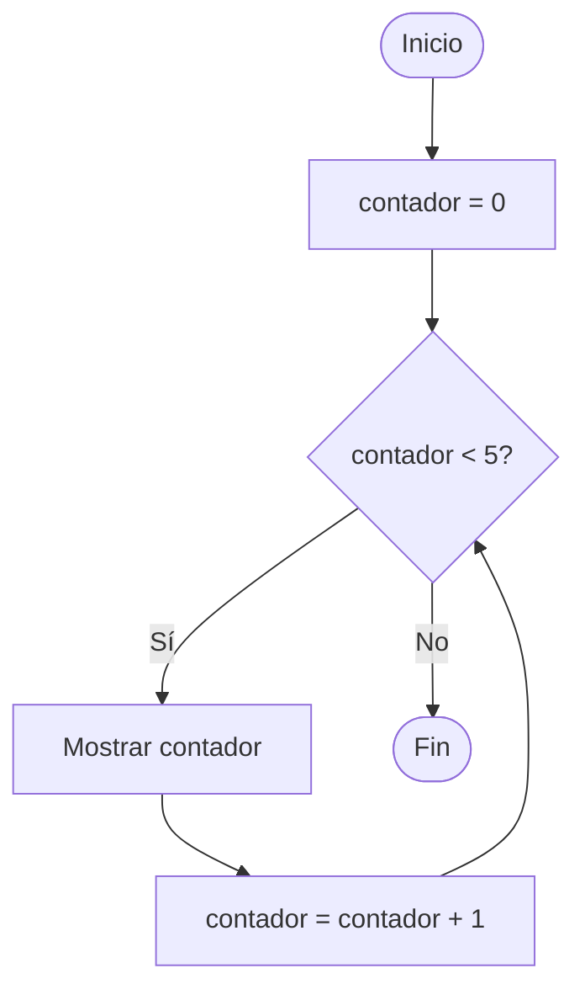
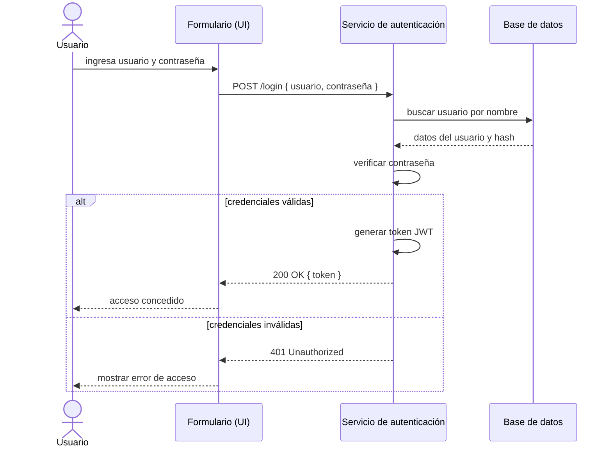

This post is a living cheatsheet: it shows how each Markdown element looks in the template. Use it as a reference while you write, and delete it once you no longer need it.

Every post starts with a small block of data (the _frontmatter_) between lines of three dashes:

```yaml
---
title: "My post"
description: "A one- or two-sentence summary."
date: 2026-01-20
lang: en
category: notes
tags: ["Markdown"]
---
```

## Headings

Use `##` for sections and `###` for subsections. The top level (`#`) is reserved for the title, so inside the text start at `##`. Headings show up on their own in the article's side table of contents.

## Text and emphasis

You can make text **bold**, _italic_, or `inline code` to refer to a command or a file name. [Links](https://astro.build) work too and, if you need it, you can ~~strike~~ something through.

## Lists

Unordered lists are good for loose ideas:

- First point
- Second point, with a detail
- Third point

And ordered ones for steps that go in sequence:

1. Write the file
2. Fill in the frontmatter
3. Publish

## Code

Inline code goes between backticks, like `pnpm dev`. For longer blocks, use three backticks and name the language so it gets highlighted. Each block comes with a copy button:

```sh
pnpm install
pnpm dev
```

```js
function greet(name) {
  return `Hello, ${name}`;
}

console.log(greet("world"));
```

## Diagrams

A fenced block named `mermaid` becomes a real diagram instead of code:





The diagram is rendered in the browser, only on pages that need it, and it follows the light/dark theme. While it loads you see the plain source, which stays available behind **View diagram source**. A diagram with invalid syntax keeps its code and shows a notice instead of breaking the page.

## Tables

Tables are handy for comparing things at a glance:

| Element | Syntax        | What for?                |
| ------- | ------------- | ------------------------ |
| Bold    | `**text**`    | Emphasize an idea        |
| Link    | `[text](url)` | Point to another page    |
| Code    | `` `code` ``  | Name a command or a file |

## Quotes and images

Blockquotes highlight a sentence or a reference:

> The best way to learn something is to write about it afterwards.

And images are inserted with a single line; they scale to the page width on their own:


That covers almost everything you'll need. From here on, the rest is just writing.
