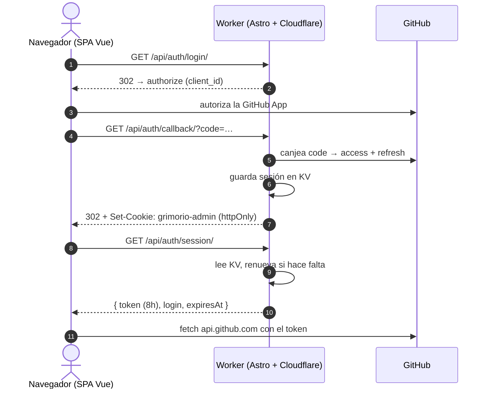

Este sitio es estático: Astro genera HTML en el build y Cloudflare lo sirve. Editar el contenido desde el navegador sin tocar Git es cómodo, pero introduce una pregunta incómoda: **¿quién autoriza el commit y con qué credencial?** Esta guía cuenta cómo respondimos esa pregunta dos veces, por qué la primera respuesta era mala y cómo llegamos a la actual. Las decisiones quedaron registradas en `specs/` dentro del repositorio.

## El problema: un sitio estático que quiere escribir

Un sitio estático no tiene servidor. Para crear o editar un post desde el navegador hay que hablar con la API de GitHub (Contents API) y firmar un commit. Eso exige una credencial con permiso de escritura sobre el repositorio. La pregunta no es *si* usar una credencial, sino **dónde vive y quién la maneja**.

## Antes: un PAT pegado en el navegador

La primera versión era la más simple posible: el editor pedía un *Personal Access Token* (PAT) fine-grained con `Contents: Read and write`, lo guardaba en `localStorage` y lo enviaba en cada request a `api.github.com`.

```text
Navegador (SPA Vue)
  ├─ localStorage: grimorio.github.token = github_pat_...
  └─ fetch("https://api.github.com/repos/.../contents/...",
           { headers: { Authorization: "Bearer github_pat_..." } })
```

Funcionaba. Crear, editar y listar posts era directo. Pero tenía tres problemas serios:

1. **El token vivía en el cliente.** Cualquier XSS, extensión maliciosa o script de terceros podía leer `localStorage` y robar un PAT de larga vida con permiso de escritura.
2. **Fricción constante.** Cada limpieza de `localStorage` (o cada navegador nuevo) obligaba a buscar el PAT, regenerarlo si había expirado y volver a pegarlo.
3. **Una credencial para todo.** El mismo token servía para el editor, para el botón del 404 y para cualquier script. Rotarlo rompía todo a la vez.

No era un error de implementación; era un error de *modelo*. Estábamos tratando un PAT como si fuera una contraseña reutilizable.

## Por qué decidimos cambiar

El detonante fue operativo: el token se borraba y había que volver a pegarlo. Pero al revisar el diseño vimos que el problema de fondo era de seguridad y de arquitectura:

- **Seguridad:** una credencial de larga vida en el navegador es un riesgo que no se mitiga con "usar expiración corta". El token sigue expuesto mientras vive.
- **Experiencia:** el login debía sobrevivir a limpiezas de storage y a cambios de navegador sin pedir nada.
- **Coherencia:** Pages CMS (el otro editor del sitio) ya usaba una GitHub App del lado servidor. Queríamos el mismo modelo de actores: la app tiene su credencial, el humano tiene su sesión.

La decisión: **mover la conversación con GitHub fuera del navegador**, a un servidor que ya existía — el Worker de Cloudflare que sirve el sitio.

## Cómo funciona ahora

La arquitectura actual tiene tres piezas: una **GitHub App**, el **Worker** del sitio y una **sesión con KV**.



Puntos clave del diseño:

- **El navegador nunca ve el `client_secret` ni el refresh token.** Solo recibe un *access token* de 8 horas, que guarda **en memoria** (no en `localStorage` ni `sessionStorage`).
- **La sesión real vive en el Worker**, en un namespace de KV (`SESSION`), detrás de una cookie `httpOnly` (`grimorio-admin`) con TTL de 90 días. Borrar `localStorage` no desautentica; borrar la cookie sí.
- **Renovación automática:** cuando el access token está a menos de un minuto de expirar, `/api/auth/session/` usa el refresh token (válido 6 meses) para emitir uno nuevo sin interacción.
- **Cuatro rutas on-demand** en `src/pages/api/auth/`: `login`, `callback`, `session` y `logout`. El resto del sitio sigue siendo estático.
- **Logout y CSRF:** **Log out** destruye la sesión y revoca el grant en GitHub (best-effort). El callback valida un `state` anti-CSRF y el logout comprueba el `Origin`, para que un enlace externo no pueda cerrarte la sesión.

### El detalle que casi nos rompe el login

Cloudflare, con `compatibility_date` reciente, **no invoca el Worker para las *navigation requests* que no coinciden con un asset**: las sirve la capa de assets (y su 404). El click en "Connect with GitHub" es una navegación a `/api/auth/login/`, así que caía en el 404 del assets en producción. La solución documentada es `assets.run_worker_first: ["/api/*"]`: el Worker atiende primero las rutas de API y las páginas siguen sirviéndose por assets.

```jsonc
// wrangler.jsonc
"assets": {
  "directory": "./dist",
  "not_found_handling": "404-page",
  "run_worker_first": ["/api/*"]
}
```

Otro detalle: `fetch()` en Workers **no envía `User-Agent` por defecto**, y GitHub lo exige. Las llamadas del lado servidor lo setean explícitamente.

## Qué requerimos

Para reproducir este esquema en otro proyecto estático necesitas:

1. **Una GitHub App** (no un PAT) con:
   - `Contents: Read and write` y `Metadata: Read-only`.
   - `Actions: Read-only` si quieres mostrar el estado del deploy.
   - **Expire user authorization tokens** activado (da el access token de 8 h + refresh de 6 meses).
   - Callback URLs con la barra final exacta (`https://<dominio>/api/auth/callback/`), porque Astro usa `trailingSlash: "always"` y GitHub redirige a la URL registrada tal cual.
2. **Un Worker de Cloudflare** con el adapter de Astro (`@astrojs/cloudflare`), que aprovisiona el KV de sesiones automáticamente.
3. **Dos secrets** en el Worker: `GITHUB_APP_CLIENT_ID` y `GITHUB_APP_CLIENT_SECRET` (`wrangler secret put`).
4. **Sesiones de Astro** activadas (`session` en `astro.config.mjs`), con cookie `httpOnly` y TTL.

Nada de base de datos propia, ni servidor Node, ni backend separado: el Worker del sitio *es* el backend.

## Qué usamos

| Pieza | Rol |
|---|---|
| Astro 7 + `@astrojs/cloudflare` | Sitio estático + rutas on-demand en el mismo Worker |
| Vue 3 (SPA del admin) | Editor: listar, crear, editar, borrar, preview |
| Cloudflare Workers + KV | Backend de auth y almacenamiento de sesiones |
| GitHub App (user-to-server) | Identidad de la app; access/refresh tokens por usuario |
| GitHub Contents API | Leer/escribir/borrar los `.md` como commits |
| GitHub Actions API | Estado del workflow Deploy (solo ese) para el indicador |

## Casos de uso que resolvemos

- **Login persistente sin PAT:** un clic en "Connect with GitHub" y la sesión sobrevive a limpiezas de storage y a reinicios del Worker.
- **Crear, editar y borrar posts** (un idioma por operación) con confirmación de dos pasos para el borrado.
- **Traducciones opcionales:** un post puede existir solo en un idioma; el 404 ofrece crear la versión que falta.
- **Indicador de deploy:** tras guardar, una cinta muestra `Deploy queued → Deploying… → Live` con enlace al run.
- **Degradación elegante:** si falta el permiso de Actions, el indicador avisa pero la edición nunca se bloquea.

Dos editores, un repo: `/admin/` cubre el ciclo de posts (crear, editar, borrar, traducciones, indicador), y **Pages CMS** sigue disponible para lo que este no hace: subida de imágenes, edición visual y borrado/renombrado. Ambos escriben commits sobre el mismo `master`, con mensajes `cms: …` coherentes entre los dos.

## Qué no resolvemos (y está bien)

- **Subida de imágenes** desde el admin (se referencian archivos que ya existen en `public/`).
- **Renombrar posts o cambiar el slug** después de crearlos.
- **Borrar ambos idiomas a la vez** o una papelera con undo (Git es la papelera).
- **Multi-usuario, roles o auditoría** dentro del admin.
- **Cancelar o reintentar el workflow** desde el editor.

Cada uno de esos, si se implementa, va en su propia iteración. El alcance se mantuvo deliberadamente pequeño.

## Alternativas que también funcionan

No hay una única respuesta correcta. Estas son las que evaluamos:

| Alternativa | Modelo | Cuándo tiene sentido |
|---|---|---|
| **Sveltia CMS** | SPA cliente + auth Worker (OAuth/GitHub App); el navegador guarda el token y llama a GitHub | Quieres un editor completo sin escribir UI; aceptas un token de usuario en el cliente |
| **Pages CMS self-hosted** | App con backend propio (Next.js + GitHub App + Postgres) | Necesitas roles, webhooks y sincronización; aceptas operar un servicio |
| **OAuth App clásica** | Token sin expiración ni refresh | Simple, pero vuelve a una credencial perpetua en el cliente |
| **Device flow** | Código de 8 dígitos por login | Cero infra, pero UX mala para web |
| **Proxy completo** | El Worker hace *todas* las llamadas a GitHub; el navegador solo tiene tu sesión | Máxima seguridad (ningún token en el cliente); más trabajo |

Elegimos el punto medio: **GitHub App + Worker + sesión KV**, con el access token en memoria del navegador. Da seguridad razonable (nada de larga vida en el cliente), buena UX (login de un clic, persistente) y cero infraestructura nueva.

**Sobre el indicador del deploy:** su alternativa más simple es que el build escriba un `version.json` con el sha del commit y que el admin lo compare. No necesita el permiso de Actions y es casi gratis, pero solo puede decir *«cambió»*: no distingue un deploy fallido de uno que todavía no arrancó ni da enlace al run. Por eso seguimos la API de Actions, que sí reporta el estado real del workflow.

## Lecciones

1. **Una credencial pertenece a un actor, no a un uso.** El PAT "para todo" fusionaba máquina, editor y script. Separarlos (app, sesión humana, token del agente) hizo el sistema auditable y rotable.
2. **El servidor que ya tienes puede ser tu backend.** No hacía falta levantar nada: el Worker del sitio estático absorbía la auth.
3. **Los detalles de plataforma importan más que el diseño.** `run_worker_first`, el `User-Agent` y la barra final del callback fueron los tres bugs reales; el modelo era correcto desde el principio.

Si tu sitio estático necesita escribir en Git, la pregunta no es "¿qué token uso?" sino "¿dónde vive la credencial y quién la renueva?". Responder eso bien es la mayor parte del trabajo.
